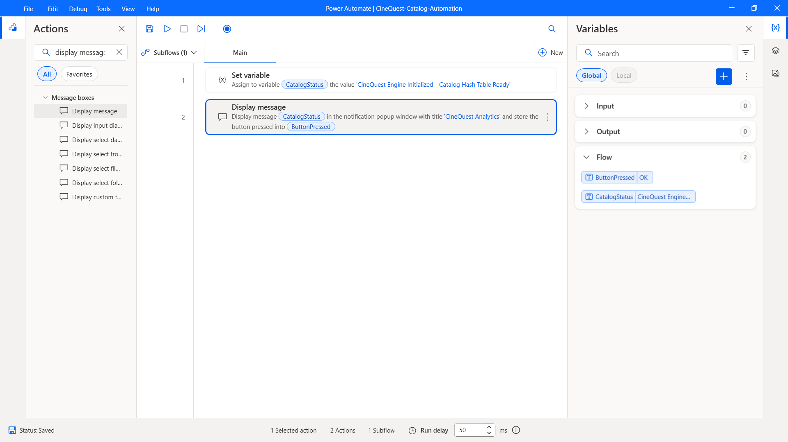

# Cinequest Movie Catalog

> A collaborative movie catalog that showcases fast searching and data analysis with hash tables, max heaps, deques, and linked lists.

---

## Project Overview

Finding a movie to watch in a 4,000-title dataset shouldn't mean scrolling through a spreadsheet. **Cinequest** is a desktop movie catalog where users create accounts, browse and search a movie dataset, curate personal watch lists, and see what other users are adding most often.

It was built as an academic project to show how classic data structures solve real application problems: each feature is backed by the structure best suited to it, rather than a one-size-fits-all list.

**The problem it solves:** raw movie datasets are large and hard to explore. Cinequest turns one into an interactive catalog with instant title lookup, genre filtering, persistent per-user lists, and a community "Trending" leaderboard.

## Key Features

- **User accounts**: register, log in, and delete your account. Passwords are stored as SHA-256 hashes, never in plain text.
- **Personal movie lists**: add and remove movies, with changes persisted to disk between sessions.
- **Browse the catalog**: scroll through all 4,000 movies in a sortable table with index, title, and genre.
- **Search by name**: hash-table lookup with an exact-match fast path and keyword fallback, plus live results as you type.
- **Search by genre**: pick a genre and list every matching movie (partial, case-insensitive matching).
- **Trending Top 10**: a max heap ranks the most-added movies across all users, and a deque stores the final leaderboard.
- **Two interfaces**: a Tkinter GUI (dark-blue and crimson theme) and a console-based version.

## Data Structures at a Glance

| Feature | Data Structure | Why |
| --- | --- | --- |
| Username duplicate checks and login lookup | **Hash table** (`dict`) | O(1) lookups |
| Registered users chain | **Linked list** (`UserNode`) | Dynamic growth, new users inserted at the head |
| Movie title search | **Hash table** with list buckets | Fast exact match; handles repeated titles |
| Genre categorization | **Hash table** (genre → list of movies) | Grouped retrieval by genre |
| Trending ranking | **Max heap** (`heapq` with negated counts) | Efficient top-N extraction |
| Top 10 results | **Deque** (`collections.deque`) | Ordered leaderboard storage |

## Data Preprocessing

The project uses `movies_updated.csv` (4,000 rows × 15 columns, sourced from [Kaggle](https://www.kaggle.com/code/yousefsaeedian/movies-dataset-visualization/input)). On startup, the pipeline:

1. Loads the CSV with Pandas using UTF-8 encoding, resolving the file location dynamically with an absolute path (`pathlib`).
2. Audits the columns, row count, and missing values.
3. Keeps only the `name` and `genre` columns needed by the app.
4. Checks for duplicate titles. Repeated names (e.g. *Hamlet*, *Scream*) are verified as distinct films that differ by release year, so no rows are removed.

---

## Tech Stack

### Frontend
- **Tkinter** (`tkinter`, `ttk`): desktop GUI with themed Treeview, Listbox, and ScrolledText widgets
- **Console UI**: text-based menu interface

### Backend
- **Python 3.9+**: core application logic
- **Pandas**: dataset loading, cleaning, and inspection
- **hashlib**: SHA-256 password hashing
- **heapq** and **collections.deque**: trending ranking engine
- **csv** and **ast**: persistence and list deserialization

### Database
- **CSV files**: `data/movies_updated.csv` (read-only movie dataset) and `data/users_data.csv` (auto-generated user accounts and personal lists)

### DevOps / Tools
- **Git** and **GitHub**: version control, feature branching (`feature/portfolio-refactor`), and pull request code reviews
- **Jupyter Notebook** (optional): the project was originally developed and documented in notebook form
- **pip**: dependency management

---

## Process Automation (RPA)

- **Engine:** Power Automate Desktop (PAD)
- **Workflow:** `CineQuest-Catalog-Automation`
- **Function:** Automates catalog status checks, execution logging, and UI analytics verification for the Cinequest desktop engine.



---

## Execution Steps

### Part 1: Installation

**Prerequisites:** Python 3.9 or newer and `pip`. Tkinter ships with the standard Python installers for Windows and macOS.

1. **Clone the repository**

   ```bash
   git clone https://github.com/dimas-data/cinequest-app.git
   cd cinequest-app
   ```

2. **Create and activate a virtual environment** (recommended)

   ```bash
   python -m venv venv

   # macOS / Linux
   source venv/bin/activate

   # Windows (PowerShell)
   venv\Scripts\Activate.ps1
   ```

3. **Install dependencies**

   ```bash
   python -m pip install pandas
   ```

   > **Linux users:** if Tkinter is missing, install it with your package manager, e.g. `sudo apt install python3-tk`.

4. **Verify the directory structure and dataset**

   The dataset is included in the repository. If `movies_updated.csv` is missing, download it from [Kaggle](https://www.kaggle.com/code/yousefsaeedian/movies-dataset-visualization/input) and place it in `data/`. Your local files should be arranged as follows:

   ```text
   cinequest-app/
   ├── assets/
   │   └── rpa-workflow.png
   ├── data/
   │   ├── movies_updated.csv
   │   └── users_data.csv        # auto-generated on first registration
   ├── src/
   │   └── finalGUI.py
   ├── .gitignore
   ├── LICENSE
   └── README.md
   ```

5. **Configure environment variables** (optional)

   Cinequest runs fully offline and needs **no API keys or secrets**. If you want configurable file paths, create a `.env` file in the project root:

   ```ini
   # .env (optional)
   MOVIES_CSV_PATH=data/movies_updated.csv
   USERS_CSV_PATH=data/users_data.csv
   ```

   > `users_data.csv` contains account data (hashed passwords). Add it and `.env` to your `.gitignore` to keep credentials and user data local.

### Part 2: Running the App

6. **Launch the desktop application**

   Run the main script from the project root:

   ```bash
   python src/finalGUI.py
   ```

   Or, if you are working from the original notebook:

   ```bash
   jupyter notebook
   ```

   Then open the notebook and run all cells in order.

7. **Create an account and log in**

   Click **REGISTER**, choose a username and password, then return to the home screen and click **LOGIN**.

8. **Explore the catalog**

   From the main menu you can:
   - **My Personal List**: view and delete saved movies
   - **Browse Movies**: scroll the full catalog and add titles
   - **Search Movies**: search by name or genre
   - **Trending Movies**: see the community Top 10 leaderboard

9. **Find your data**

   On first registration, the app creates `data/users_data.csv`. Your account and personal list persist there between sessions.

---

## Contributing

Contributions, issues, and feature suggestions are welcome. Fork the repository, create a feature branch, and open a pull request.

## Legal & Licensing

- **Disclaimer:** This project is for academic and portfolio demonstration purposes and is **not affiliated** with Cinequest Inc. or any of its film festivals.
- **License:** Distributed under the [MIT License](LICENSE).